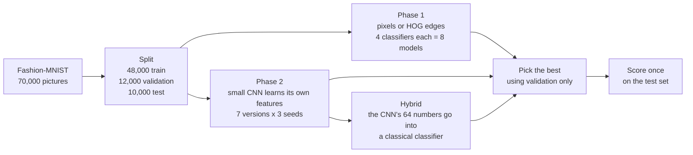

# Inventory Image Tagging

### 👉 [Try it live: inventory-image-tagging.streamlit.app](https://inventory-image-tagging.streamlit.app/)

Upload a picture of a clothing item and the app tells you which of ten categories it is. No install and no sign-in. The first prediction can be slow because a free-hosted app may need a moment to wake up. The live app uses the Phase 1 models.

Project 11. We classify Fashion-MNIST, 70,000 small grayscale pictures of clothes in ten categories (T-shirt, Trouser, Pullover, Dress, Coat, Sandal, Shirt, Sneaker, Bag, Ankle boot). **Phase 1** uses classical machine learning. **Phase 2** adds a small neural network (a CNN) and compares it with Phase 1.

## What we did



- **Phase 1:** pixels use the brightness of every point. HOG summarises which way edges point in small patches. Logistic Regression, k-NN, Random Forest and linear SVM each run on both, so there are 8 models.
- **Phase 2:** a CNN learns its own description of each picture. We train seven versions with three seeds each to see which ingredients matter (batch normalisation, dropout, augmentation, depth). A hybrid gives the CNN's learned 64 numbers to a Phase 1 classifier.
- **Fair test:** every model trains on the same 48,000 pictures. Settings are chosen on 12,000 separate validation pictures. The official 10,000 test pictures are scored once, after the choices are saved.

## Results

<!-- RESULTS_START -->
Validation selects Pixels + RF. It achieves 87.61% accuracy and macro F1 0.8747 on the official test set after training on all 48,000 images. See the results, errors and timings in [Phase 1 findings](reports/phase1_findings.md).
<!-- RESULTS_END -->

| Model | Test accuracy | Macro F1 |
|---|---:|---:|
| **Phase 2 hybrid:** CNN features + Random Forest | **92.49%** (±0.19) | 0.9246 |
| **Phase 2 CNN** | **91.98%** (±0.24) | 0.9194 |
| Phase 1: Pixels + Random Forest (best of Phase 1) | 87.61% | 0.8747 |
| Phase 1: Pixels + k-NN | 85.09% | 0.8515 |
| Phase 1: HOG + Random Forest | 84.59% | 0.8455 |
| Phase 1: HOG + Logistic Regression | 84.55% | 0.8450 |
| Phase 1: HOG + linear SVM | 84.01% | 0.8385 |
| Phase 1: Pixels + linear SVM | 83.97% | 0.8373 |
| Phase 1: Pixels + Logistic Regression | 83.96% | 0.8390 |
| Phase 1: HOG + k-NN | 83.81% | 0.8382 |

CNN and hybrid are the mean of three training runs (± is the spread). Macro F1 averages the score of the ten categories, so each counts equally.

- The CNN beats the best Phase 1 model by about 4 points. The hybrid adds about half a point more.
- **Shirt** is the hardest category. Its recall rose from 59% (Phase 1) to 74% (CNN) and 76% (hybrid). Pullover mistaken for Coat fell from 116 to 33 pictures.
- Most ablation choices made less difference than the run-to-run spread. Heavy dropout (0.4) hurt.
- The CNN takes 0.17 ms per picture on a CPU. The Phase 1 forest takes about 25 ms.

Details: [Phase 1 findings](reports/phase1_findings.md) and [Phase 2 findings](reports/phase2_findings.md).

## Run it on your Mac

You need a Mac with Python 3.11 or 3.12 (check with `python3.12 --version` or `python3.11 --version`) and about 2 GB of free space (about 3 GB with Phase 2).

```bash
git clone https://github.com/aryankinha/inventory-image-tagging.git
cd inventory-image-tagging
bash scripts/setup_mac.sh --pip
bash scripts/start_dashboard.sh
```

Open <http://localhost:8501>. Press Control+C to stop. Next time, run only the last command.

- Setup creates its own environment, so you never activate anything by hand. It lives under `~/venvs/`, so folder names with spaces or a colon are fine.
- No Python 3.11 or 3.12? Install one from [python.org](https://www.python.org/downloads/).
- Prefer [uv](https://docs.astral.sh/uv/getting-started/installation/)? Use `bash scripts/setup_mac.sh` without `--pip`.
- The first prediction needs internet. The app downloads the model it needs from the [model release](https://github.com/aryankinha/inventory-image-tagging/releases/tag/phase1-models-v2), checks its checksum and keeps a copy.

The dashboard opens on **Predict**: upload a picture or pick a sample, then click **Predict**. **Results** shows the scores of the 8 Phase 1 models, **Mistakes** shows which categories get confused, and **About** explains how it works. The models were trained on small benchmark pictures. Ordinary photos work best when the item is upright, alone and on a plain background. We have not measured accuracy on photos.

## Run Phase 2

Phase 2 needs PyTorch. It is kept out of the Phase 1 setup so the live dashboard stays small. After the setup above:

```bash
bash scripts/run_python.sh -m pip install -r requirements-phase2.txt
bash scripts/run_python.sh -m pytest -q
bash scripts/run_python.sh -m jupyterlab notebooks/phase2.ipynb
```

If you set up with uv, use `uv pip install --python .venv/bin/python3 -r requirements-phase2.txt` for the first line. Re-running `uv sync` removes PyTorch again.

The notebook reads the saved results and checkpoints, so it needs no download and no training. Choose the kernel **Python (Inventory Tagging)**.

To retrain everything yourself (about 40 minutes on an Apple M-series Mac; it downloads the dataset if needed):

```bash
bash scripts/build_phase2.sh
```

Output goes to `runs/phase2/` and never overwrites the saved results. The stages run in order: `ablation` (21 training runs), `select`, `hybrid`, then `test`, which scores the test pictures once. You can run a single stage with `bash scripts/run_python.sh -m src.inventory_tagging_dl.cli ablation --work-dir runs/phase2`. Training on the Apple GPU is not exactly repeatable, so scores can differ slightly from ours.

## Check that it works

```bash
bash scripts/run_python.sh -m pytest -q
bash scripts/run_python.sh scripts/verify_results.py
bash scripts/run_python.sh scripts/check_dashboard.py
```

Tests for Phase 2 run only when PyTorch is installed. A few more are skipped on a fresh clone because they need the dataset.

## Train the Phase 1 models yourself (optional)

You do not need this to use the app. It downloads the dataset and trains all 8 Phase 1 models from scratch:

```bash
bash scripts/build_models.sh
```

Leave Terminal open until it finishes. Results go to `runs/phase1/` and never overwrite our saved results. To view them, type `runs/phase1` in the dashboard sidebar under **Local setup** (**Results folder**). To predict from the command line after that:

```bash
bash scripts/run_python.sh -m src.inventory_tagging.cli --work-dir runs/phase1 predict assets/sample.png
```

The image must be 28×28 pixels, grayscale and upright on a dark background.

## Phase 1 notebook

```bash
bash scripts/run_python.sh -m src.inventory_tagging.cli prepare
bash scripts/run_python.sh -m jupyterlab notebooks/phase1.ipynb
```

`prepare` downloads the training pictures (about 25 MB).

## Reports and slides

| | Phase 1 | Phase 2 |
|---|---|---|
| Findings | [phase1_findings.md](reports/phase1_findings.md) | [phase2_findings.md](reports/phase2_findings.md) |
| IEEE report | [PDF](reports/phase1_report/main.pdf), [LaTeX](reports/phase1_report/main.tex) | [PDF](reports/phase2_report/main.pdf), [LaTeX](reports/phase2_report/main.tex) |
| Slides | [pptx](reports/presentation/phase1.pptx), [PDF](reports/presentation/phase1.pdf) | [pptx](reports/presentation/phase2.pptx), [PDF](reports/presentation/phase2.pdf) |
| Notebook | [phase1.ipynb](notebooks/phase1.ipynb) | [phase2.ipynb](notebooks/phase2.ipynb) |
| Literature review | [docs/literature_review.md](docs/literature_review.md) | [docs/dl_literature_review.md](docs/dl_literature_review.md) |
| Viva guide | [docs/viva_guide.md](docs/viva_guide.md) | [docs/phase2_viva_guide.md](docs/phase2_viva_guide.md) |
| Requirements checklist | [docs/phase1_checklist.md](docs/phase1_checklist.md) | [docs/phase2_checklist.md](docs/phase2_checklist.md) |

Also: [dashboard details](docs/DASHBOARD.md) and [fresh clone check](docs/FRESH_CLONE_CHECK.md).

## Folder map

| Folder | What is inside |
|---|---|
| `src/inventory_tagging/` | Phase 1: data loading, features, models, training, evaluation |
| `src/inventory_tagging_dl/` | Phase 2: the CNN, ablation, hybrid, final test |
| `dashboard/`, `app.py` | the Streamlit app |
| `scripts/` | setup, start, build and check commands |
| `reports/` | saved results, figures, reports, slides (`reports/phase2/` holds the Phase 2 evidence and three small CNN checkpoints) |
| `assets/` | sample pictures |
| `docs/` | literature reviews, viva guides, checklists, attribution, team |

Folders `data/`, `models/` and `runs/` are created on your computer and are not in Git.

## Limits

- One split, a small settings search, and three random seeds for Phase 2 (one for Phase 1).
- Fashion-MNIST is a well-known, small, centred benchmark, so these numbers say little about a real store catalogue or phone photos.
- The CNN is not in the live dashboard.

## Credits

Built on ideas from a supplied reference project, listed in [attribution](docs/ATTRIBUTION.md). Dataset: Fashion-MNIST by Zalando Research (MIT license). Team details are in [docs/team.md](docs/team.md).

## Hosting

The live app runs on Streamlit Community Cloud from branch `main`, entry file `app.py`, Python 3.12. It needs no secrets and does not install PyTorch.
