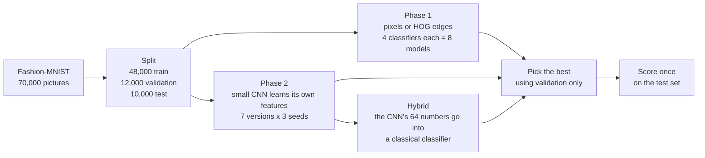

# Inventory Image Tagging

### [Try it live: inventory-image-tagging.streamlit.app](https://inventory-image-tagging.streamlit.app/?view=predict)

Upload a picture of a clothing item and the app tells you which of ten categories it is. No install and no sign-in. The first prediction can be slow because a free-hosted app may need a moment to wake up. The live app offers the Phase 1 models and the Phase 2 CNN.

[Predict an image](https://inventory-image-tagging.streamlit.app/?view=predict) · [Compare results](https://inventory-image-tagging.streamlit.app/?view=results) · [Explore mistakes](https://inventory-image-tagging.streamlit.app/?view=mistakes)

Project 11. We classify Fashion-MNIST, 70,000 small grayscale pictures of clothes in ten categories (T-shirt, Trouser, Pullover, Dress, Coat, Sandal, Shirt, Sneaker, Bag, Ankle boot). **Phase 1** uses classical machine learning. **Phase 2** adds a small neural network (a CNN) and compares it with Phase 1.

## What we did



- **Phase 1:** pixels use the brightness of every point. HOG summarises which way edges point in small patches. Logistic Regression, k-NN, Random Forest and linear SVM each run on both, so there are 8 models.
- **Phase 2:** a CNN learns its own description of each picture. We train seven versions with three seeds each to see which ingredients matter (batch normalisation, dropout, augmentation, depth). A hybrid gives the CNN's learned 64 numbers to a Phase 1 classifier.
- **Fair test:** every model trains on the same 48,000 pictures. Settings are chosen on 12,000 separate validation pictures. The official 10,000 test pictures are scored once, after the choices are saved.

## Results

<!-- RESULTS_START -->
Validation selects Pixels + RF. It achieves 87.61% accuracy and macro F1 0.8747 on the official test set after training on all 48,000 images. See the results, errors and timings in [Phase 1 findings](reports/phase1_findings.md).
<!-- RESULTS_END -->

| Model | Test accuracy | Macro F1 |
|---|---:|---:|
| **Phase 2 hybrid:** CNN features + Random Forest | **92.49%** (±0.19) | 0.9246 |
| **Phase 2 CNN** | **91.98%** (±0.24) | 0.9194 |
| Phase 1: Pixels + Random Forest (best of Phase 1) | 87.61% | 0.8747 |
| Phase 1: Pixels + k-NN | 85.09% | 0.8515 |
| Phase 1: HOG + Random Forest | 84.59% | 0.8455 |
| Phase 1: HOG + Logistic Regression | 84.55% | 0.8450 |
| Phase 1: HOG + linear SVM | 84.01% | 0.8385 |
| Phase 1: Pixels + linear SVM | 83.97% | 0.8373 |
| Phase 1: Pixels + Logistic Regression | 83.96% | 0.8390 |
| Phase 1: HOG + k-NN | 83.81% | 0.8382 |

CNN and hybrid are the mean of three training runs (± is the spread). Macro F1 averages the score of the ten categories, so each counts equally.

- The CNN beats the best Phase 1 model by about 4 points. The hybrid adds about half a point more.
- **Shirt** is the hardest category. Its recall rose from 59% (Phase 1) to 74% (CNN) and 76% (hybrid). Pullover mistaken for Coat fell from 116 to 33 pictures.
- Most ablation choices made less difference than the run-to-run spread. Heavy dropout (0.4) hurt.
- The CNN takes 0.17 ms per picture on a CPU. The Phase 1 forest takes about 25 ms.

Details: [Phase 1 findings](reports/phase1_findings.md) and [Phase 2 findings](reports/phase2_findings.md).

## Run it on your Mac

You need a Mac with Python 3.11 or 3.12 (check with `python3.12 --version` or `python3.11 --version`) and about 2 GB of free space (about 3 GB with Phase 2).

Clone the complete project first:

```bash
git clone https://github.com/aryankinha/inventory-image-tagging.git
cd inventory-image-tagging
```

Choose **one** setup method. Both install the same locked packages and create an isolated environment.

### Option A: uv

Install [uv](https://docs.astral.sh/uv/getting-started/installation/) first, then run:

<!-- readme: setup-uv -->
```bash
bash scripts/setup_mac.sh
```

### Option B: pip

Use your installed Python 3.11 or 3.12. Check it with `python3 --version`, then run:

<!-- readme: setup-pip -->
```bash
bash scripts/setup_mac.sh --pip
```

The pip helper creates a virtual environment under `~/venvs/` and installs `requirements.txt` with `python3 -m pip`. The uv helper uses `.venv/` in the clone. You never need to activate either environment; the run scripts select the right one. Spaces and a colon in the project path are supported.

### Open the dashboard

<!-- readme: dashboard -->
```bash
bash scripts/start_dashboard.sh
```

Open <http://localhost:8501>. Press Control+C to stop. Next time, run only that command.

- No suitable Python installed? Get Python 3.12 or 3.11 from [python.org](https://www.python.org/downloads/).
- The first Phase 1 prediction needs internet. The app downloads the requested model from the [model release](https://github.com/aryankinha/inventory-image-tagging/releases/tag/phase1-models-v2), verifies its checksum and keeps a local copy.

The dashboard opens on **Predict**: upload a picture or pick a sample, choose a model, then click **Predict**. The preview and answer appear alongside the controls. Picture adjustments and comparisons are collapsed until needed. **Results** shows the scores of the 8 Phase 1 models, **Mistakes** shows which categories get confused, and **About** explains how it works. The models were trained on small benchmark pictures. Ordinary photos work best when the item is upright, alone and on a plain background. We have not measured accuracy on photos. The ordinary-photo option now removes plain backgrounds and offers cropping and rotation; inspect the preview before predicting. See [photo input checks and limitations](docs/PHOTO_INPUTS.md).

## Run Phase 2

Both phases are included on `main`. After the setup above, add Phase 2 using the **same method**:

With uv:

<!-- readme: phase2-uv -->
```bash
bash scripts/setup_mac.sh --phase2
```

With pip:

<!-- readme: phase2-pip -->
```bash
bash scripts/setup_mac.sh --pip --phase2
```

These commands also work directly on a new clone if you want both phases from the start. uv uses the locked `phase2` group; pip installs its exported `requirements-phase2.txt`. The hosted app installs that group with the CPU-only PyTorch wheel on Linux. Hybrid inference stays local because its exported forest is not published.

Already using your own activated Python 3.11/3.12 virtual environment? The direct pip commands are:

<!-- readme: manual-pip -->
```bash
python3 -m pip install -r requirements-phase2.txt
python3 -m pip check
```

For Phase 1 alone, use `python3 -m pip install -r requirements.txt` instead. The helper run scripts are for environments registered by `setup_mac.sh`. In your own activated environment, start the app directly:

<!-- readme: manual-dashboard -->
```bash
python3 -m streamlit run app.py
```

Check an included image with the saved CNN, without downloading a dataset or retraining:

<!-- readme: cnn-predict -->
```bash
bash scripts/run_python.sh -m src.inventory_tagging_dl.cli predict --image assets/sample.png
```

In the local dashboard, select **Neural model**, choose an image and click **Predict image**. The saved CNN predicts one of ten categories. Ordinary PNG/JPEG photos need the explicitly labelled experimental preparation mode. Command-line photo mode uses `--photo --isolate` for background removal, or `--photo --invert` for the resize-only alternative. Its accuracy is unmeasured.

The frozen CNN checkpoints are included in Git. Hybrid classifier files are rebuilt locally from the frozen CNNs and training data, and are excluded from Git because of their size:

<!-- readme: hybrid-export -->
```bash
bash scripts/run_python.sh -m src.inventory_tagging.cli prepare
bash scripts/run_python.sh -m src.inventory_tagging_dl.cli export
bash scripts/run_python.sh -m src.inventory_tagging_dl.cli predict --image assets/sample.png --model hybrid
```

This export fits only the already selected classifier on training-image features. It does not tune settings or repeat the official test evaluation. Its checksum is recorded in `reports/phase2/inference.json`. CPU rebuilding can produce a few different predictions from the original GPU-feature run; the original reported scores remain the recorded experiment.

```bash
bash scripts/run_python.sh -m jupyterlab notebooks/phase2.ipynb
```

The notebook reads saved results and verified checkpoints. It needs no download and no training. Choose **Python (Inventory Tagging)**. To replay predictions on already downloaded official test archives without fitting, use `scripts/verify_phase2.py --replay`.

To retrain everything yourself (about 40 minutes on an Apple M-series Mac; it downloads the dataset if needed):

```bash
bash scripts/build_phase2.sh
```

Output goes to `runs/phase2/` and never overwrites the saved results. The stages run in order: `ablation` (21 training runs), `select`, `hybrid`, then `test`, which scores the test pictures once. You can run a single stage with `bash scripts/run_python.sh -m src.inventory_tagging_dl.cli ablation --work-dir runs/phase2`. Training on the Apple GPU is not exactly repeatable, so scores can differ slightly from ours.

## Check that it works

Run these checks after either setup method:

<!-- readme: checks -->
```bash
bash scripts/run_python.sh -m pytest -q
bash scripts/run_python.sh scripts/verify_results.py
bash scripts/run_python.sh scripts/check_dashboard.py
bash scripts/run_python.sh scripts/verify_artifacts.py
```

With Phase 2 installed, also run:

<!-- readme: phase2-checks -->
```bash
bash scripts/run_python.sh scripts/verify_phase2.py
bash scripts/run_python.sh -m src.inventory_tagging.cli prepare
bash scripts/run_python.sh scripts/check_notebooks.py
```

The Phase 1 notebook needs the training archives, so this step downloads and verifies them first. The Phase 2 notebook itself can read the saved results without a dataset download.

For the complete data-dependent checks and a replay of the saved CNN predictions:

<!-- readme: full-data-checks -->
```bash
bash scripts/run_python.sh -c "from src.inventory_tagging.data import prepare; prepare(include_test=True)"
bash scripts/run_python.sh -m pytest -q --junitxml=.runtime-cache/full-data-tests.xml
bash scripts/run_python.sh scripts/verify_phase2.py --replay
```

This downloads the official test archives for verification only. It does not train, tune or overwrite the reported experiment.

The [**README reproducibility** GitHub workflow](https://github.com/aryankinha/inventory-image-tagging/actions/workflows/compatibility.yml) makes a complete, separate clone of the exact commit being checked, in a path containing spaces and a colon. It executes the setup and check blocks above for uv and pip on Python 3.11 and 3.12. It also checks the first published-model download, the saved CNN prediction, rebuilding the frozen hybrid classifiers, and actual dashboard startup. Each job starts without local datasets, models or environments, then follows the documented archive downloads for the notebook and full-data checks. Pip's direct commands above are checked inside its new virtual environment too.

Phase 1 deliberately skips deep-learning tests until Phase 2 is installed. A fresh clone also skips three tests that need optional local dataset archives. Those skips are shown in the initial logs, not counted as passes; the final full-data check must run without skips. The workflow verifies the saved experiment and runs inference; it does not retrain the 21-run study or promise identical GPU training results. The optional retraining commands below remain separate.

## Train the Phase 1 models yourself (optional)

You do not need this to use the app. It downloads the dataset and trains all 8 Phase 1 models from scratch:

```bash
bash scripts/build_models.sh
```

Leave Terminal open until it finishes. Results go to `runs/phase1/` and never overwrite our saved results. To view them, type `runs/phase1` in the dashboard sidebar under **Local setup** (**Results folder**). To predict from the command line after that:

```bash
bash scripts/run_python.sh -m src.inventory_tagging.cli --work-dir runs/phase1 predict assets/sample.png
```

The image must be 28×28 pixels, grayscale and upright on a dark background.

## Phase 1 notebook

```bash
bash scripts/run_python.sh -m src.inventory_tagging.cli prepare
bash scripts/run_python.sh -m jupyterlab notebooks/phase1.ipynb
```

`prepare` downloads the training pictures (about 25 MB).

## Reports and slides

| | Phase 1 | Phase 2 |
|---|---|---|
| Findings | [phase1_findings.md](reports/phase1_findings.md) | [phase2_findings.md](reports/phase2_findings.md) |
| IEEE report | [PDF](reports/phase1_report/main.pdf), [LaTeX](reports/phase1_report/main.tex) | [PDF](reports/phase2_report/main.pdf), [LaTeX](reports/phase2_report/main.tex) |
| Slides | [pptx](reports/presentation/phase1.pptx), [PDF](reports/presentation/phase1.pdf) | [pptx](reports/presentation/phase2.pptx), [PDF](reports/presentation/phase2.pdf) |
| Notebook | [phase1.ipynb](notebooks/phase1.ipynb) | [phase2.ipynb](notebooks/phase2.ipynb) |
| Literature review | [docs/literature_review.md](docs/literature_review.md) | [docs/dl_literature_review.md](docs/dl_literature_review.md) |
| Viva guide | [docs/viva_guide.md](docs/viva_guide.md) | [docs/phase2_viva_guide.md](docs/phase2_viva_guide.md) |
| Requirements checklist | [docs/phase1_checklist.md](docs/phase1_checklist.md) | [docs/phase2_checklist.md](docs/phase2_checklist.md) |

Also: [dashboard details](docs/DASHBOARD.md) and [fresh clone check](docs/FRESH_CLONE_CHECK.md).

## Folder map

| Folder | What is inside |
|---|---|
| `src/inventory_tagging/` | Phase 1: data loading, features, models, training, evaluation |
| `src/inventory_tagging_dl/` | Phase 2: the CNN, ablation, hybrid, final test |
| `dashboard/`, `app.py` | the Streamlit app |
| `scripts/` | setup, start, build and check commands |
| `reports/` | saved results, figures, reports, slides (`reports/phase2/` holds the Phase 2 evidence and three small CNN checkpoints) |
| `assets/` | sample pictures |
| `docs/` | literature reviews, viva guides, checklists, attribution, team |

Folders `data/`, `models/` and `runs/` are created on your computer and are not in Git.

## Limits

- One split, a small settings search, and three random seeds for Phase 2 (one for Phase 1).
- Fashion-MNIST is a well-known, small, centred benchmark, so these numbers say little about a real store catalogue or phone photos.
- The hosted app can run the committed CNN. Hybrid prediction still needs the local Phase 2 setup and its exported classifier; that larger file is not published.

## Credits

Built on ideas from a supplied reference project, listed in [attribution](docs/ATTRIBUTION.md). Dataset: Fashion-MNIST by Zalando Research (MIT license). Team details are in [docs/team.md](docs/team.md).

## Hosting

The live app runs on Streamlit Community Cloud from branch `main`, entry file `app.py`, Python 3.12. It needs no secrets. The lockfile installs the CPU-only PyTorch build on Linux so the **Neural model** page can run the committed CNN; hybrid prediction remains local.
