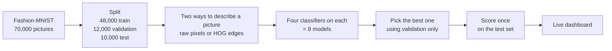

# Inventory Image Tagging

### 👉 [Try it live: inventory-image-tagging.streamlit.app](https://inventory-image-tagging.streamlit.app/)

Upload a picture of a clothing item and the app tells you which of ten categories it is. No install and no sign-in. The first prediction can be slow because a free-hosted app may need a moment to wake up.

Project 11, Phase 1. We use classical machine learning (no neural networks yet) on the Fashion-MNIST dataset: 70,000 small grayscale pictures of clothes in ten categories (T-shirt, Trouser, Pullover, Dress, Coat, Sandal, Shirt, Sneaker, Bag, Ankle boot).

## What we did



- **Pixels** use the brightness of every point in the picture.
- **HOG** summarises which way the edges point in small patches of the picture.
- **Classifiers:** Logistic Regression, k-NN, Random Forest and linear SVM. Each runs on both descriptions, so there are 8 models.
- **Fair test:** every model trains on the same 48,000 pictures. We chose settings on 12,000 separate validation pictures and looked at the official 10,000 test pictures only after our choices were fixed.

## Results

<!-- RESULTS_START -->
Validation selects Pixels + RF. It achieves 87.61% accuracy and macro F1 0.8747 on the official test set after training on all 48,000 images. See the results, errors and timings in [Phase 1 findings](reports/phase1_findings.md).
<!-- RESULTS_END -->

In short: the best model is **Pixels + Random Forest** (RF), chosen on validation data.

| Model | Test accuracy | Macro F1 |
|---|---:|---:|
| Pixels + Random Forest | 87.61% | 0.8747 |
| Pixels + k-NN | 85.09% | 0.8515 |
| HOG + Random Forest | 84.59% | 0.8455 |
| HOG + Logistic Regression | 84.55% | 0.8450 |
| HOG + linear SVM | 84.01% | 0.8385 |
| Pixels + linear SVM | 83.97% | 0.8373 |
| Pixels + Logistic Regression | 83.96% | 0.8390 |
| HOG + k-NN | 83.81% | 0.8382 |

Macro F1 averages the score of the ten categories, so each category counts equally.

HOG helped some models and hurt others, so it is not an automatic upgrade. The hardest category is **Shirt** (59% of shirts found). The model mixes up shirts, T-shirts, pullovers and coats. Details are in [Phase 1 findings](reports/phase1_findings.md).

## Run it on your Mac

You need a Mac with Python 3.11 or 3.12 (check with `python3.12 --version` or `python3.11 --version`) and about 2 GB of free space.

```bash
git clone https://github.com/aryankinha/inventory-image-tagging.git
cd inventory-image-tagging
bash scripts/setup_mac.sh --pip
bash scripts/start_dashboard.sh
```

Open <http://localhost:8501>. Press Control+C to stop. Next time, run only the last command.

- Setup creates its own environment, so you never activate anything by hand. It lives under `~/venvs/`, so folder names with spaces or a colon are fine.
- No Python 3.11 or 3.12? Install one from [python.org](https://www.python.org/downloads/).
- Prefer [uv](https://docs.astral.sh/uv/getting-started/installation/)? Use `bash scripts/setup_mac.sh` without `--pip`.
- The first prediction needs internet. The app downloads the model it needs from the [model release](https://github.com/aryankinha/inventory-image-tagging/releases/tag/phase1-models-v2), checks its checksum and keeps a copy.

### Using the dashboard

1. **Predict** (opens first): upload a picture or pick a sample, then click **Predict**.
2. **Results**: scores for all 8 models.
3. **Mistakes**: which categories get confused.
4. **About**: how it works.

The model was trained on small benchmark pictures. Ordinary photos work best when the item is upright, alone and on a plain background. We have not measured accuracy on photos.

## Check that it works

```bash
bash scripts/run_python.sh -m pytest -q
bash scripts/run_python.sh scripts/verify_results.py
bash scripts/run_python.sh scripts/check_dashboard.py
```

## Train the models yourself (optional)

You do not need this to use the app. It downloads the dataset and trains all 8 models from scratch:

```bash
bash scripts/build_models.sh
```

Leave Terminal open until it finishes. Results go to `runs/phase1/` and never overwrite our saved results. To view them, type `runs/phase1` in the dashboard sidebar under **Local setup** (**Results folder**). Scores can differ slightly between computers.

To predict from the command line after that:

```bash
bash scripts/run_python.sh -m src.inventory_tagging.cli --work-dir runs/phase1 predict assets/sample.png
```

The image must be 28×28 pixels, grayscale and upright on a dark background.

## Notebook

```bash
bash scripts/run_python.sh -m src.inventory_tagging.cli prepare
bash scripts/run_python.sh -m jupyterlab notebooks/phase1.ipynb
```

`prepare` downloads the training pictures (about 25 MB). Choose the kernel **Python (Inventory Tagging)**.

## Report and slides

- [Phase 1 findings](reports/phase1_findings.md)
- [IEEE report (PDF)](reports/phase1_report/main.pdf), [LaTeX source](reports/phase1_report/main.tex)
- [Presentation](reports/presentation/phase1.pptx), [PDF](reports/presentation/phase1.pdf)
- [Teaching notebook](notebooks/phase1.ipynb)
- [Viva guide](docs/viva_guide.md), [requirements checklist](docs/phase1_checklist.md), [literature review](docs/literature_review.md)
- [Dashboard details](docs/DASHBOARD.md), [fresh clone check](docs/FRESH_CLONE_CHECK.md)

## Folder map

| Folder | What is inside |
|---|---|
| `src/inventory_tagging/` | data loading, features, models, training, evaluation |
| `dashboard/`, `app.py` | the Streamlit app |
| `scripts/` | setup, start, build and check commands |
| `reports/` | saved results, figures, report, slides |
| `assets/` | sample pictures |
| `docs/` | literature review, viva guide, attribution, team |

Folders `data/`, `models/` and `runs/` are created on your computer and are not in Git.

## Limits

- One split and one random seed, with a small settings search.
- Fashion-MNIST is a well-known benchmark, so these numbers say little about a real store catalogue.
- Phase 2 adds a small CNN and compares it with these 8 models.

## Credits

Built on ideas from a supplied reference project, listed in [attribution](docs/ATTRIBUTION.md). Dataset: Fashion-MNIST by Zalando Research (MIT license). Team details are in [docs/team.md](docs/team.md).

## Hosting

The live app runs on Streamlit Community Cloud from branch `main`, entry file `app.py`, Python 3.12. It needs no secrets.
